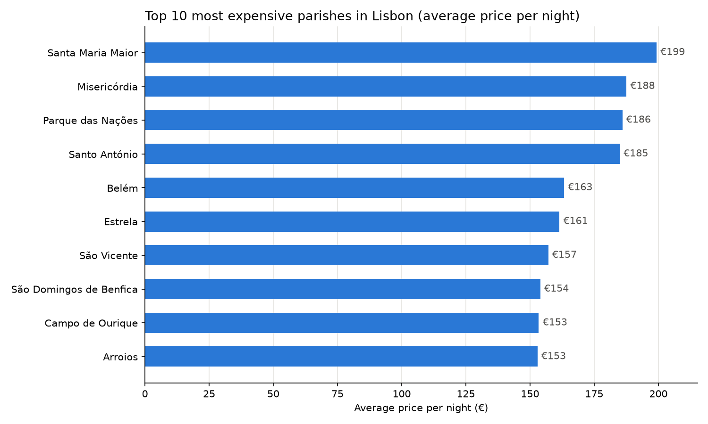

# Overview

As a software engineer, I want to learn how to use code to explore real data and answer questions with it. I already have experience with tools like Power BI and SQL, so in this project I wanted to do a similar analysis with Python and the Pandas library.

I analyzed the Airbnb listings in the Lisbon area. The data comes from [Inside Airbnb](https://insideairbnb.com/get-the-data/), and I used the detailed `listings.csv.gz` file from September 19, 2026. The file has 25,020 listings and 90 columns, including the price per night, the parish (neighbourhood), the municipality, the room type, and the reviews. The data covers the city of Lisbon and 15 nearby municipalities, like Cascais and Sintra. The data is shared under the Creative Commons Attribution 4.0 (CC BY 4.0) licence.

My purpose for writing this software was to practice the main steps of data analysis: loading data, cleaning it, filtering, grouping, sorting, and creating a chart. I also wanted to learn how to justify my answers by comparing the average and the median.

To run the program:

```
python3 -m venv .venv
source .venv/bin/activate
pip install -r requirements.txt
python analysis.py
```

[Software Demo Video](http://youtube.link.goes.here)

# Data Analysis Results

Before the analysis, I cleaned the data. The price was saved as text (for example `"$1,200.00"`), so I converted it to numbers. I removed 2,977 listings with no price and 230 listings with a price over €1,000 per night, because they were less than 1% of the data and they were not realistic. After cleaning, I used 21,813 listings. The average price went down from €194.58 to €171.68, but the median almost did not change (from €140 to €139). This shows that a few extreme prices were making the average too high. I also fixed some parish names that lost their Portuguese letters (for example, "Belm" became "Belém").

**Question 1: Which parishes in the city of Lisbon have the highest average price per night?**

The most expensive parishes are in the historic and tourist center. Santa Maria Maior (Baixa, Alfama) is first, with an average of €199 and a median of €169, and it also has the most listings (3,391). It is followed by Misericórdia (€188), Parque das Nações (€186), and Santo António (€185). The median confirms this ranking, so the result is not caused by a few expensive listings. Parque das Nações is a surprise, because it is a modern area, not a historic one. The cheapest parishes are residential areas far from the center: Lumiar (€119), Santa Clara (€111), and Beato (€105). I only included parishes with at least 30 listings.



**Question 2: Which room type is the most common, and how does its price compare with the other types?**

Entire homes and apartments are the most common type, with 76.1% of all listings. On average, an entire home costs €194 per night, which is about 2 times the price of a private room (€95). The median shows the same difference (€158 vs. €75). Hotel rooms have the highest average price (€313), but there are only 133 of them, and their median is much lower (€190), so a few very expensive hotels make the average high.

**Question 3 (extra): Is the city of Lisbon more expensive than nearby towns?**

No. By average price, the city of Lisbon is number 7 of 13 municipalities (€169). Cascais is the most expensive area, with an average of €197 and the highest median (€155, the same as Alenquer). Lourinhã has the highest average (€198), but its median is only €140, so a few large and expensive houses raise its average. The cheapest municipalities are residential suburbs: Amadora (€96), Odivelas (€109), and Loures (€124). One reason may be that there are more large houses for groups outside the city, so the price per night is higher even if the price per person is not.

# Development Environment

I used these tools to develop the software:

- Visual Studio Code
- Git and GitHub
- The macOS Terminal

I wrote the program in Python 3.15 and used these libraries:

- **Pandas:** to read the CSV file, clean the data, filter, group, and sort it.
- **Matplotlib:** to create the bar chart.

All the code is in `analysis.py`. The dataset is in the `data` folder, and the chart is saved as `top_parishes_chart.png`.

# Useful Websites

* [Inside Airbnb – Get the Data](https://insideairbnb.com/get-the-data/)
* [pandas – Getting started tutorials](https://pandas.pydata.org/docs/getting_started/intro_tutorials/index.html)
* [pandas – Group by: split-apply-combine](https://pandas.pydata.org/docs/user_guide/groupby.html)
* [pandas – read_csv](https://pandas.pydata.org/docs/reference/api/pandas.read_csv.html)
* [Matplotlib – Horizontal bar chart](https://matplotlib.org/stable/gallery/lines_bars_and_markers/barh.html)
* [Matplotlib – Bar label demo](https://matplotlib.org/stable/gallery/lines_bars_and_markers/bar_label_demo.html)

# Future Work

* Compare the price per guest using the `accommodates` column, to make a fairer comparison between small apartments and large houses.
* Analyze the relationship between price and review scores.
* Create more charts, for example one for room types and one for municipalities.
* Fix all the names with missing Portuguese letters automatically, instead of using a fixed list.